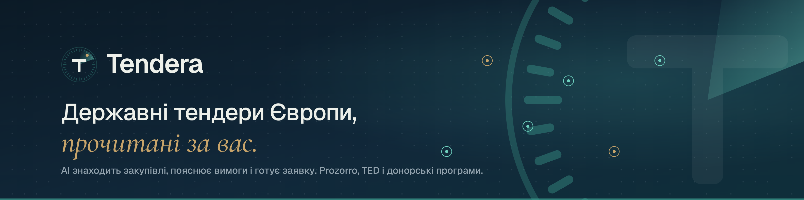

# Tendera

AI-платформа для державних і донорських тендерів у Європі: щоранку знаходить закупівлі, які компанія може виграти, пояснює вимоги за 30 секунд і готує заявку.



## Що тут є

| Шлях | Що це |
| --- | --- |
| `/` | Лендінг (UA / EN): живі фото, анімована карта Європи, AI-бриф, тарифи |
| `/app/` | Демо застосунку: онбординг, огляд, стрічка тендерів, AI-бриф і вердикт, чат з документацією, pipeline з drag & drop, робоче місце заявки з генерацією чернетки, бібліотека документів, аналітика, налаштування, ⌘K-палітра, світла і темна теми |
| `/auth/` | Реєстрація компанії (3 кроки, перевірка ЄДРПОУ / NIP), вхід, вхід за посиланням, відновлення пароля |
| `/app/?demo=1` | Демо застосунку без реєстрації |
| `/legal/` | Політика конфіденційності та умови використання |
| `/brand/` | Бренд-кит: живий логотип, знак, аватарка, банер, кольори, шрифти |

Усе статичне (HTML, CSS, vanilla JS), без збірки — відкривається на GitHub Pages як є.

## Запуск локально

```bash
python3 -m http.server 8000
# відкрийте http://localhost:8000
```

## Реєстрація (Supabase)

1. Supabase → SQL Editor → вставте і запустіть `supabase/schema.sql` (повторний запуск безпечний). Створяться таблиці компаній, профілів, команди, стану застосунку й запрошень з Row Level Security, а компанія створюється автоматично під час реєстрації.
2. Authentication → URL Configuration:
   - **Site URL:** `https://angelinaua15-bit.github.io/Tendera/`
   - **Redirect URLs:** `https://angelinaua15-bit.github.io/Tendera/**` (і `http://localhost:8000/**` для локальної розробки)
3. У `assets/js/config.js` — URL проєкту і **publishable** ключ. Secret / service_role ключ у код не додавайте ніколи.


- `assets/js/config.js` — email для заявок на Enterprise-демо.
- `app/data.js` — демо-дані (тендери, бібліотека, команда). Усі тендери, замовники й люди в демо вигадані.

## Ресурси та ліцензії

- Шрифти Geist і Cormorant Garamond — SIL Open Font License, підключені локально (`assets/fonts`).
- Карта Європи — точкова матриця, згенерована з даних Natural Earth (public domain) через `world-atlas`.
- Фото — [Unsplash](https://unsplash.com) (Unsplash License): Enes Gundogdu, Danist Soh, dominik hofbauer, Vitaly Gariev, Scott Graham, Sander Weeteling, Wes Hicks, Christina @ wocintechchat, American Public Power Association.
- Оцінка ринку $13 трлн — [Open Contracting Partnership і Spend Network](https://www.open-contracting.org/global-procurement-spend).

© 2026 Tendera
